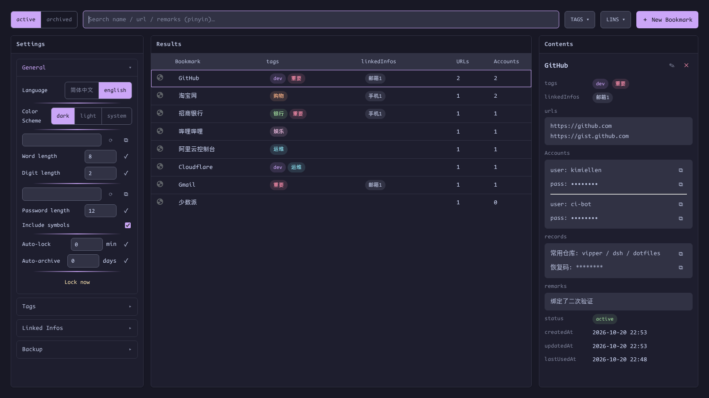
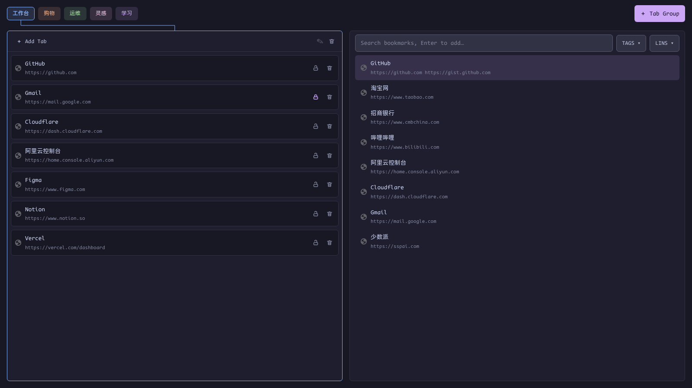

<div align="center">
  
  <h1>vipper</h1>
  <p><strong>A tab switcher · bookmark manager · password &amp; info keeper for Chrome</strong></p>
  <p>
    <a href="README.md">English</a> | <a href="README.zh-CN.md">简体中文</a>
  </p>
  <p>
    
    
    
    
  </p>
</div>



vipper is a Chrome Manifest V3 extension that combines three everyday tools in one keyboard-first package:

1. **Tab switcher** — two-dimensional keyboard navigation across tab groups (`Alt+H/L` between groups, `Alt+J/K` within a group)
2. **Tab group manager** — your own snapshot library of tab groups (`Alt+,`): reopen a whole group after a browser restart, keep it in sync with the live Chrome group, and freeze pages you don't want overwritten
3. **Bookmark + password manager** — an encrypted vault for bookmarks, accounts, and private notes, fully independent of Chrome's built-in systems, with one-key autofill and automatic save-on-login

Everything is driven by keyboard-first thinking: open, search, fill, and organize without leaving the keyboard.

## Features

**Tab switcher**

- `Alt+H/L` switches **tab groups**; `Alt+J/K` switches tabs **within a group**
- A contiguous run of ungrouped tabs acts as an implicit group — plain tabs join the navigation too
- Each group remembers its last-active tab; switching collapses all other groups
- No wrap-around, scoped to the current window — multiple Chrome windows never interfere

**Tab group manager**

- `Alt+,` opens the group manager: a row of colored group chips plus the selected group's pages and a bookmark search panel
- Each group is a **vipper-owned snapshot** (name + one of Chrome's 9 group colors + ordered pages) — reopening rebuilds a real Chrome tab group; Chrome's own saved tab groups have no extension API, so the two are independent stores
- **Live two-way sync** while a group is open: pages added / closed / navigated / dragged in or out of the Chrome group flow back into the snapshot, and edits here (remove, reorder, add) act on the browser tabs immediately
- **Lock a page** to freeze it: closing or navigating it in the browser never overwrites the snapshot, so next open still has it
- Closing a single tab removes its page; closing the window or the whole group only clears the live mapping — the snapshot survives, which is the whole point after a browser restart
- **Create, edit, and delete groups** right here: inline forms (name + Chrome's 9 colors) update the chips immediately and sync an open Chrome group's title and color; deletion asks for confirmation and removes only the snapshot and mapping — tabs already open in the browser stay open
- **Opening focuses the group**: tabs are rebuilt in snapshot order as a real Chrome group, the first entry is activated, and other groups in the window collapse; an already-open group is activated, not duplicated, and open vipper groups are ordered to match the chips
- **Long-press 400 ms to reorder chips**; `←/→` walks the chips, `Enter` opens the group, `/` jumps to the search box and `Ctrl+/` back to the chips; pinyin search (same index as the bookmark vault) plus TAGS/LINS filters, `↑/↓` to pick a result, `Enter` appends it to the group
- `+add tab` takes a URL by hand or grabs the current tab; long-press to drag pages into order
- Snapshots are local and survive browser restarts; an extension reload clears only the live mapping, and the group is recognized again by title + color



Full walkthrough with screenshots: **[Tab group manager](docs/guide/groups.md)**.

**Bookmark + password manager**

- `Alt+.` toggles the manager window: search, multi-select TAGS/LINS filters, details, and in-place editing in one view
- Search covers name / URL / remarks, plus **Chinese pinyin** (initials and full spelling): `yh` finds 银行, `tb` finds 淘宝
- `Alt+P` fills credentials on a login page, Bitwarden-style, with per-character typing and a field bounce animation
- Multiple URLs per bookmark with `host / exact / prefix` match rules; multiple accounts per bookmark with an arrow-key picker
- **Save-on-login**: submit a login form and vipper offers to create the entry or append the new account — one click, encrypted on save
- Free-form records per bookmark: plain `note` and encrypted `secret` (recovery codes, API keys, …)
- Tags with Catppuccin colors and linked infos (phone / email / WeChat) are reference-safe: entries in use can't be deleted
- Archive old entries (manual or auto after N days), import/export as JSON for git-friendly backups
- **Import native Chrome bookmarks** in one click: pages are appended, folder paths go into remarks, duplicates are skipped, existing entries stay untouched, and everything is tagged 浏览器书签导入
- Catppuccin Mocha/Latte themes and 中文/English UI

## Security model

- Master password + **PBKDF2-SHA256 (600k iterations)** + **AES-GCM**, WebCrypto only — zero third-party crypto dependencies
- Only `account.password` and `secret.content` are ciphertext; everything else stays searchable plaintext
- The key **lives in `chrome.storage.session` only** — never persisted; the vault locks on every browser restart
- Credentials captured at login live in service-worker memory only, and are discarded silently when locked
- No "forgot password" backdoor by design — see [Security](docs/guide/security.md)

## Keyboard shortcuts

| Shortcut | Action |
|---|---|
| `Alt+H` / `Alt+L` | Switch to previous / next tab group |
| `Alt+J` / `Alt+K` | Switch tab within the group |
| `Alt+.` | Toggle the manager window (bind once, see installation) |
| `Alt+,` | Toggle the tab group manager (bind once) |
| `Alt+P` | Fill credentials on the current login page (bind once) |

> Chrome caps an extension at 4 preset shortcuts, so `Alt+.`, `Alt+,` and `Alt+P` are bound manually in `chrome://extensions/shortcuts` — a one-time, 30-second step.

## Prerequisites (Chrome side)

vipper does not take over Chrome's native systems — configure these to your liking:

- **Tab groups are a native Chrome feature**: right-click any tab → "Add tab to new group". Enabling "Save and sync tab groups" in Chrome settings saves groups to the bookmark bar and syncs them across devices — fully independent of vipper's own bookmark vault
- **Native bookmarks and password manager keep working**: vipper stores bookmarks / credentials completely separately and neither disables nor reads Chrome's counterparts. Whether Chrome's own "save password" prompt stays on is your choice under Settings → Autofill and passwords → Google Password Manager
- **Shortcut conflicts**: if the four navigation keys (`Alt+H/J/K/L`) or the three manual keys (`Alt+.` / `Alt+,` / `Alt+P`) clash with other extensions, adjust them in `chrome://extensions/shortcuts`

## Installation

### Build requirements

| Requirement | Version | Notes |
|---|---|---|
| Node.js | **≥ 22** | Required by WXT 0.21; check with `node -v` |
| pnpm | **≥ 9** | The repo uses a pnpm v9 lockfile; don't mix npm / yarn, or the lockfile will be ignored |
| Chrome / Chromium | Manifest V3 capable | Only needed to load the extension; the build itself doesn't require a browser |

All dependencies are pure JavaScript — no Python or C++ toolchain is required.

If pnpm is not installed yet:

```bash
npm install -g pnpm
```

### Build and load

```bash
pnpm install
pnpm build
```

Then load `.output/chrome-mv3` via `chrome://extensions` → Developer mode → **Load unpacked**, and bind the three manual shortcuts.

Full walkthrough — including the Hyprland window rules that make the popup float and center on Wayland: **[Installation guide](docs/guide/installation.md)**

## User guide

Everyday operations, one page each, with screenshots:

- [Installation & shortcuts](docs/guide/installation.md) — load the extension, bind keys, Hyprland rules
- [Tab navigation](docs/guide/tab-navigation.md) — the two-dimensional model and its exact semantics
- [Tab group manager](docs/guide/groups.md) — chips, snapshot rebuild, locking, live sync
- [Bookmark manager](docs/guide/bookmarks.md) — search, pinyin, filters, opening, in-place editing
- [Autofill (Alt+P)](docs/guide/autofill.md) — match rules, multi-account picker, iframe logins
- [Save on login](docs/guide/auto-save.md) — the save/append prompt after you log in
- [Tags, linked infos & archive](docs/guide/organization.md) — keeping the vault tidy
- [Backup: import & export](docs/guide/backup.md) — plaintext JSON, full-restore semantics, additive native-bookmark import
- [Settings](docs/guide/settings.md) — theme, language, generators, lock & archive policies
- [Security model](docs/guide/security.md) — encryption details and password reset

## Development

```bash
pnpm dev          # WXT dev server with HMR
pnpm build        # production build → .output/chrome-mv3
pnpm typecheck    # strict tsc
```

Milestone-level acceptance scripts live in `scripts/` (CDP-driven, run against headless Chromium). The illustrated guide screenshots are reproducible via `node scripts/docs-shot.mjs`.

## License

[MIT](LICENSE) © 2026 kimiellen
