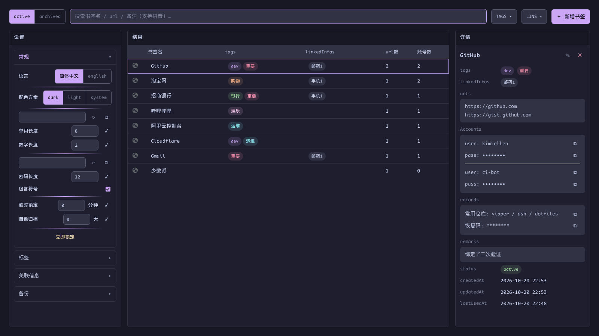

<div align="center">
  
  <h1>vipper</h1>
  <p><strong>标签快捷切换器 · 书签管理器 · 密码及书签信息管理器</strong></p>
  <p>
    <a href="README.md">English</a> | <a href="README.zh-CN.md">简体中文</a>
  </p>
  <p>
    
    
    
    
  </p>
</div>



vipper 是一个 Chrome Manifest V3 扩展，把两件日常工具装进同一个键盘优先的入口：

1. **标签切换器**——在标签组之间 ↑/↓、组内 ←/→ 的二维导航，灵感来自 Hyprland 等平铺窗口管理器
2. **书签 + 密码管理器**——完全独立于 Chrome 原生系统的加密仓库，管理书签、账号与私密记录，支持一键填充和登录后自动保存

所有操作都围绕方向键设计：打开、搜索、填充、整理，全程不碰鼠标。

## 功能特点

**标签切换器**

- `Alt+H/L` 切换**标签组**；`Alt+J/K` 在**组内**切换标签
- 连续的一段未分组标签视为隐式组——普通散标签也参与导航
- 每组记忆上次活跃的标签；切组时自动折叠其他组
- 边界不环绕，仅作用于当前窗口——多个 Chrome 窗口互不干扰

**书签 + 密码管理器**

- `Alt+.` 呼出管理页：搜索、TAGS/LINS 多选过滤、详情、原地编辑，一屏完成
- 搜索覆盖书签名 / url / 备注，并支持**中文拼音**（首拼与全拼）：`yh` 命中银行，`tb` 命中淘宝
- `Alt+P` 在登录页主动填充账号密码（Bitwarden 式），逐字符键入 + 字段弹跳动画
- 一条书签可绑多个 URL（`host / exact / prefix` 匹配规则）与多组账号（方向键二级菜单选择）
- **登录自动保存**：提交登录表单后，vipper 弹窗询问新建条目或追加账号——一键加密落盘
- 记录区分明文 `note` 与加密 `secret`（恢复码、API Key 等），不限量
- tag（Catppuccin 配色）与关联信息（手机/邮箱/微信）先建后选，被引用的条目拒绝删除
- 条目归档（手动或超期自动）、JSON 导入导出，适合用 git 做本地备份
- Catppuccin Mocha/Latte 双主题、中英双语界面

## 安全模型

- 主密码 + **PBKDF2-SHA256（60 万次迭代）** + **AES-GCM**，只用浏览器原生 WebCrypto——零第三方加密依赖
- 只有 `account.password` 与 `secret.content` 是密文，其余字段保持明文以支持检索
- 密钥**只存 `chrome.storage.session`**——永不落盘；浏览器每次重启即锁定
- 登录时捕获的凭据只暂存于 service worker 内存，锁定状态下直接丢弃
- 按设计**不提供"忘记密码"入口**——详见[安全模型](docs/guide/zh-CN/security.md)

## 快捷键

| 快捷键 | 作用 |
|---|---|
| `Alt+H` / `Alt+L` | 切换到上一个 / 下一个标签组 |
| `Alt+J` / `Alt+K` | 组内向左 / 向右切换标签 |
| `Alt+.` | 呼出 / 关闭管理页（需手动绑定一次，见安装指南） |
| `Alt+P` | 在当前登录页填充账号密码（需手动绑定一次） |

> Chrome 限制每个扩展最多预置 4 个快捷键，因此 `Alt+.` 与 `Alt+P` 需在 `chrome://extensions/shortcuts` 手动绑定——一次性操作，30 秒完成。

## 安装

```bash
pnpm install
pnpm build
```

然后在 `chrome://extensions` 开启开发者模式 → **加载已解压的扩展程序** → 选择 `.output/chrome-mv3`，再绑定两个快捷键。

完整步骤——包括让弹窗在 Wayland 下浮动居中的 Hyprland 窗口规则：**[安装指南](docs/guide/zh-CN/installation.md)**

## 使用手册

按操作分类，每篇独立成页、图文配合：

- [安装与快捷键](docs/guide/zh-CN/installation.md)——加载扩展、绑键、Hyprland 规则
- [标签导航](docs/guide/zh-CN/tab-navigation.md)——二维模型与精确语义
- [书签管理](docs/guide/zh-CN/bookmarks.md)——搜索、拼音、过滤、打开、原地编辑
- [主动填充（Alt+P）](docs/guide/zh-CN/autofill.md)——匹配规则、多账号菜单、iframe 登录
- [登录自动保存](docs/guide/zh-CN/auto-save.md)——登录后的新建 / 追加弹窗
- [标签、关联信息与归档](docs/guide/zh-CN/organization.md)——让仓库保持整洁
- [备份：导入与导出](docs/guide/zh-CN/backup.md)——明文 JSON、全量恢复语义
- [设置](docs/guide/zh-CN/settings.md)——主题、语言、生成器、锁定与归档策略
- [安全模型](docs/guide/zh-CN/security.md)——加密细节与密码重置

## 开发

```bash
pnpm dev          # WXT 开发服务器（HMR）
pnpm build        # 生产构建 → .output/chrome-mv3
pnpm typecheck    # 严格模式 tsc
```

里程碑级验收脚本在 `scripts/`（CDP 驱动，运行于 headless Chromium）。手册配图可通过 `node scripts/docs-shot.mjs` 复现。

## 许可证

[MIT](LICENSE) © 2026 kimiellen
