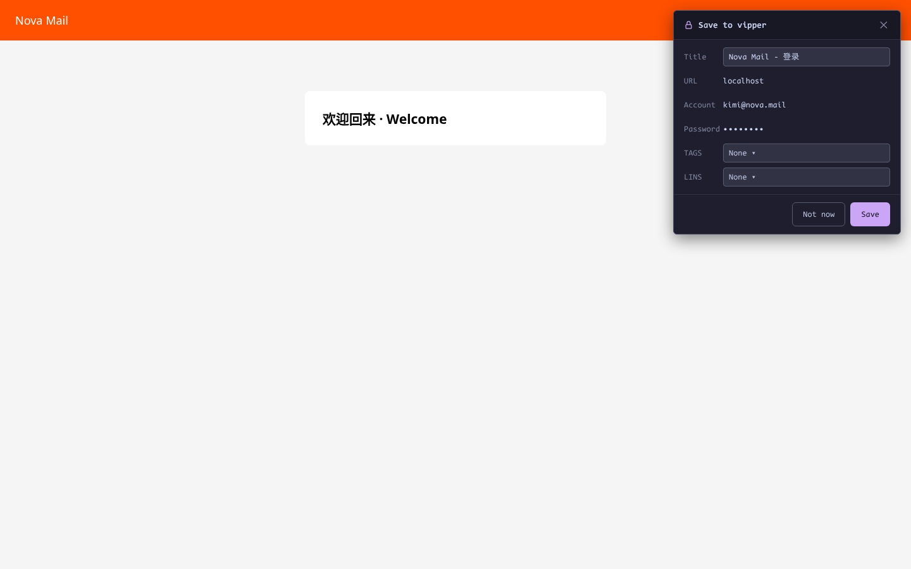
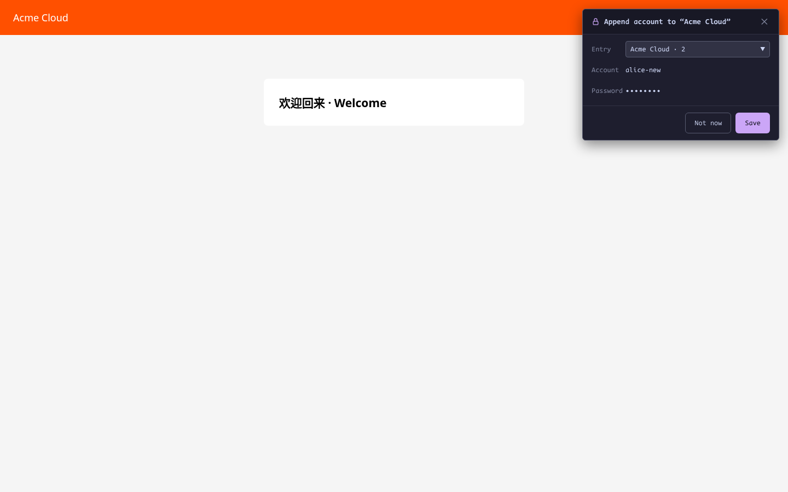

# Save on Login

[English](auto-save.md) | [简体中文](zh-CN/auto-save.md) · [← Back to README](../../README.md)

---

Log in to a site as usual. If vipper doesn't already hold that credential, a non-blocking card slides into the **top-right corner** after the page settles — no modal, no stolen focus.

## New entry

No bookmark matches the site → the card offers to create one: editable title, read-only URL/account, masked password, and optional TAG/LINS picks:

**Save** encrypts and stores the entry (URL match rule defaults to `host`). **Don't save**, `Esc`, or `✕` discards it.

## Append an account

A bookmark matches but doesn't contain this username → the card offers to **append** the account to an existing entry (dropdown defaults to the most recently used match):

If any matching bookmark already contains that username, vipper stays silent — no password-update prompt; change passwords deliberately in the [editor](bookmarks.md#editing-in-place).

## When nothing appears

- The vault is **locked** — captures are discarded silently, never staged in plaintext
- Registration / change-password forms (two visible password boxes) are ignored
- Re-submitting values identical to the last Alt+P fill in that frame is ignored (nothing changed)
- Archived entries don't match — a login on an archived site is treated as new

## Privacy of the capture

Captured credentials live only in the service worker's **memory** — never written to storage, never logged. Saving encrypts them immediately; discarding clears them. A service-worker restart loses a pending capture rather than risking a wrong write.

## Known boundaries

- Login success can't be detected reliably — a failed login may also prompt; the card stays neutral and cancellable
- Multi-step logins with no visible username step (password-only) aren't captured; popup-window or new-tab logins may be missed
