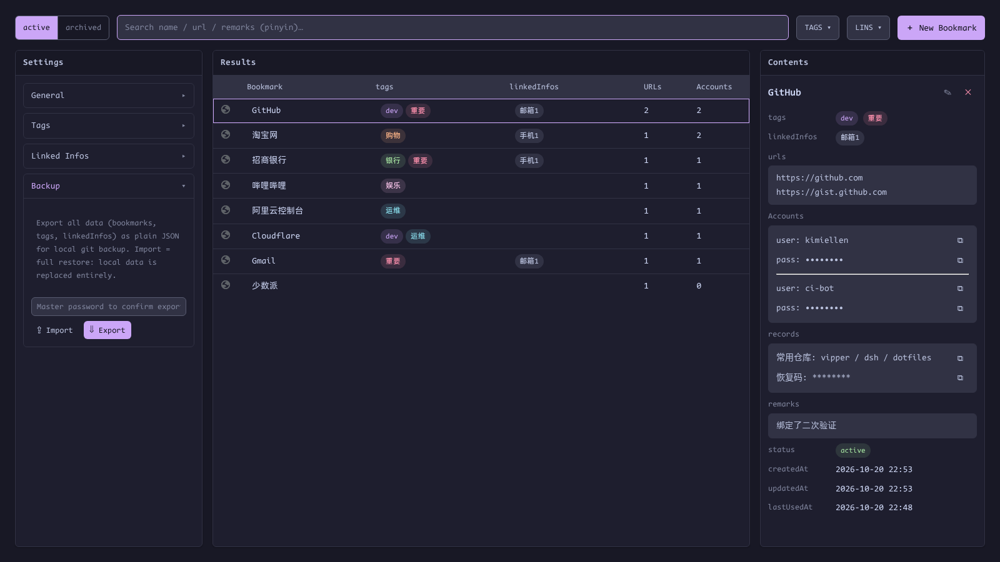

# Backup: Import & Export

[English](backup.md) | [简体中文](zh-CN/backup.md) · [← Back to README](../../README.md)

---

Settings → **Backup**:

## Export

One click exports the **entire vault as plaintext JSON** — bookmarks (active + archived), tags, linked infos, and settings. You must enter the master password on the spot to confirm.

Plaintext export is an intentional design: the file is meant to be committed to a **local git repository** as your backup trail. Treat the file like a password database — because it is one.

## Import

Import is **data recovery, not merge**: after validating the file structure, vipper wipes the current bookmarks and management tables and writes the file's contents. It also requires the master password — nobody can overwrite your vault by dropping a file onto an unlocked window.

- Sensitive fields from the file are re-encrypted with *your* key on write

## Recommended routine

1. Export after meaningful changes
2. Commit the JSON to a local (private) git repo
3. Restore = import the last good export

Symlinking the extension's LevelDB directory works in principle but is not recommended — binary churn makes for noisy diffs and fragile restores.
