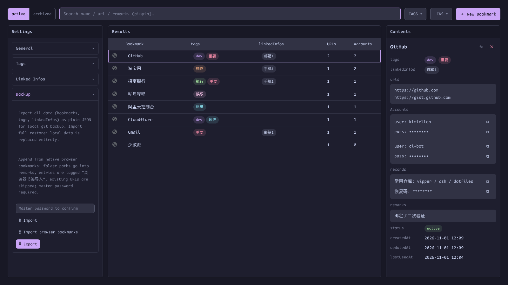

# Backup: Import & Export

[English](backup.md) | [简体中文](zh-CN/backup.md) · [← Back to README](../../README.md)

---

Settings → **Backup**:

## Export

One click exports the **entire vault as plaintext JSON** — bookmarks (active + archived), tags, linked infos, and settings. You must enter the master password on the spot to confirm.

Plaintext export is an intentional design: the file is meant to be committed to a **local git repository** as your backup trail. Treat the file like a password database — because it is one.

## Import

Import is **data recovery, not merge**: after validating the file structure, vipper wipes the current bookmarks and management tables and writes the file's contents. It also requires the master password — nobody can overwrite your vault by dropping a file onto an unlocked window.

- Sensitive fields from the file are re-encrypted with *your* key on write

## Browser bookmark import

Chrome's native bookmarks can be pulled straight into the vault — no HTML export, no file picker. vipper reads the live bookmark tree, flattens it, and appends every page as a new vault entry.

### What gets imported

- Every bookmark **that has a URL**, from the bookmarks bar, “Other bookmarks”, and any nested folder (folders themselves are not entries)
- The original title; an empty title falls back to the URL
- The folder path, written to **remarks** — e.g. `Bookmarks bar / Dev / Vue`; remarks remain searchable
- The tag **浏览器书签导入** on every imported entry (vipper creates it in `sapphire` on first use, then reuses it)
- Entries land as **active**, with `createdAt` kept from Chrome's `dateAdded` and `lastUsedAt` set to the import time, so they surface at the top of the list

### How it works (additive, never destructive)

- **Append, not restore**: existing bookmarks and the tag / linked-info tables are left untouched — unlike the JSON import above, nothing is wiped
- **Duplicates are skipped**: URLs are compared after normalisation (`URL.href`, so trailing slashes and host casing don't matter). A URL already in the vault — active or archived — is skipped and counted
- **One password gate**: the same master-password field guards export, JSON import, and browser import; a wrong password writes nothing
- **Batched write**: the batch is written in one storage pass with a single index update, so importing hundreds of bookmarks stays fast
- vipper only **reads** Chrome's bookmarks — it never adds, moves, or deletes them

### How to import

1. Open the manager (`Alt+.`) and expand **Settings → Backup**
2. Type your master password in the field
3. Click **⇪ Import browser bookmarks**
4. Read the result line, e.g. `Import complete: 12 added, 3 duplicates skipped`
5. The new entries are already in the list — clear the search or switch back to `active` if you were filtering

> The extension needs the `bookmarks` permission. On the first load after an update Chrome may ask you to accept “Read and change your bookmarks”; until you do, the import button reports a missing-permission error.

### Notes & limits

- Chrome's bookmark **folders** are not recreated; the path lives in remarks. Use tags or linked infos afterwards if you want a richer structure
- Only title, URL, folder path, and creation date are carried over — icons and visit metadata are not
- Re-running the import is safe: every URL already present is skipped

## Recommended routine

1. Export after meaningful changes
2. Commit the JSON to a local (private) git repo
3. Restore = import the last good export

Symlinking the extension's LevelDB directory works in principle but is not recommended — binary churn makes for noisy diffs and fragile restores.
