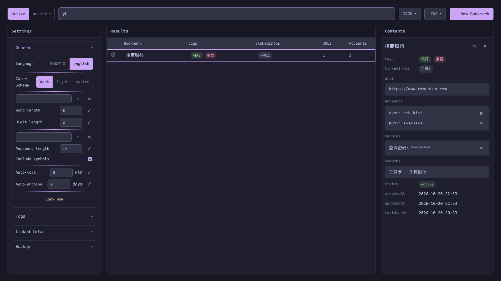
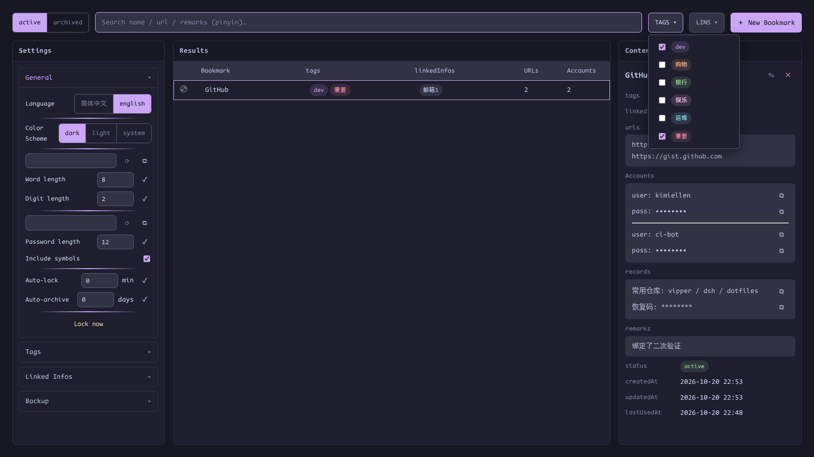
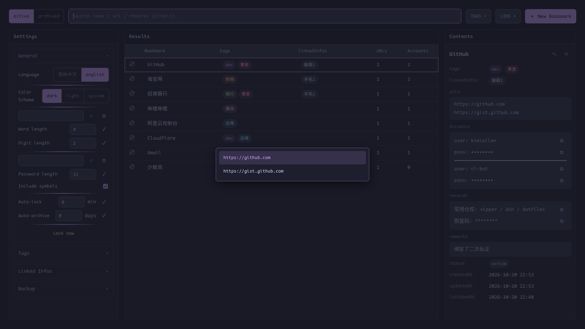
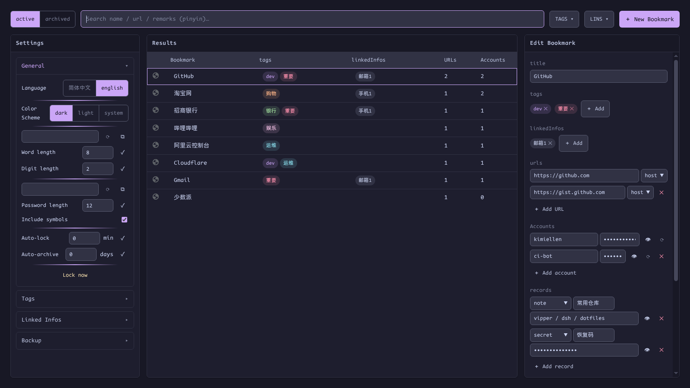

# Bookmark Manager

[English](bookmarks.md) | [简体中文](zh-CN/bookmarks.md) · [← Back to README](../../README.md)

---

Press `Alt+.` to toggle the manager window. It is a single fixed-height page with four areas:

- **Toolbar** — active/archived switch, search, TAGS/LINS multi-select filters, New Bookmark
- **Settings** — accordion (general, tags, linked infos, backup)
- **Results** — the bookmark table, sorted by last-used, favicon first column
- **Contents** — details of the selected entry; turns into the editor in place

## Search — including Chinese pinyin

Search matches the bookmark **name, URL, and remarks**. Chinese titles and remarks additionally match **pinyin initials and full spelling**:

`yh` or `yinhang` finds 招商银行, `tb` / `taobao` finds 淘宝网. Polyphones are handled at word level (重庆 → `cq`, 长沙 → `cs`). URLs are matched literally, without pinyin conversion.

## TAGS / LINS filters

The two dropdowns in the toolbar multi-select tags and linked infos. Multiple selections combine with **AND** semantics:

Your filter selection is remembered **for the browser session**: close the window with `Alt+.` and reopen it — the same view comes back. A browser restart resets it; deleted tags are pruned automatically on restore. The search term and the active/archived switch are not restored.

## Opening bookmarks

Select a row and press `Enter`. The bookmark opens in the **tab group of the tab you came from** — the new tab joins your current context instead of landing at the end of the strip. If the bookmark has several URLs, an arrow-key submenu appears:

`Esc` closes the submenu, then the window.

## Editing in place

Click `✎` in the contents area (or **＋ New Bookmark**) — the contents area becomes the editor without leaving the page:

- Field order mirrors the detail view: title → tags → linked infos → urls → accounts → records → remarks → status, with the three read-only timestamps at the bottom
- **urls**: each URL carries a match rule — `host` (default, hostname only), `exact` (origin + pathname), or `prefix` — used by Alt+P and save-on-login to decide whether a page belongs to this bookmark
- **accounts**: any number of username/password pairs, with show/hide and a password generator
- **records**: repeatable `note` (plaintext) and `secret` (encrypted, masked as `*`) entries — recovery codes, API keys, security answers…
- Tags and linked infos are **create-first, select-later**: they must exist in Settings before they can be attached, preventing near-duplicate entries

`Esc` cancels; deleting a bookmark asks for confirmation.
