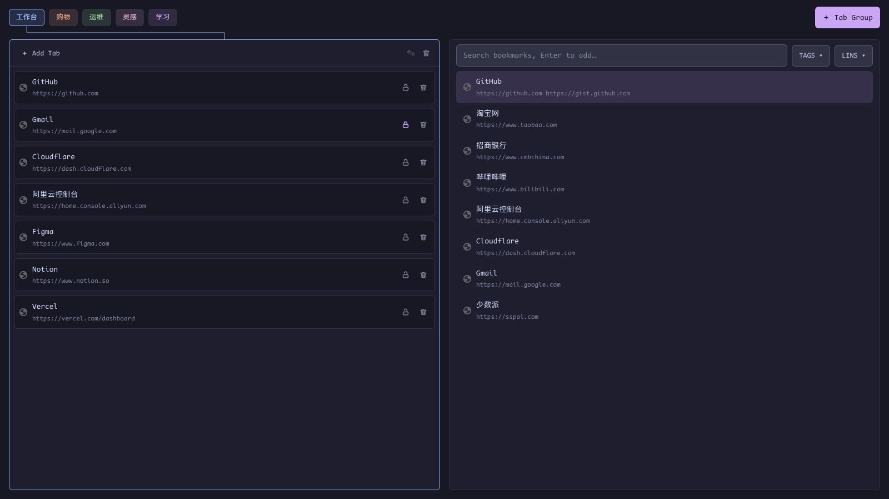
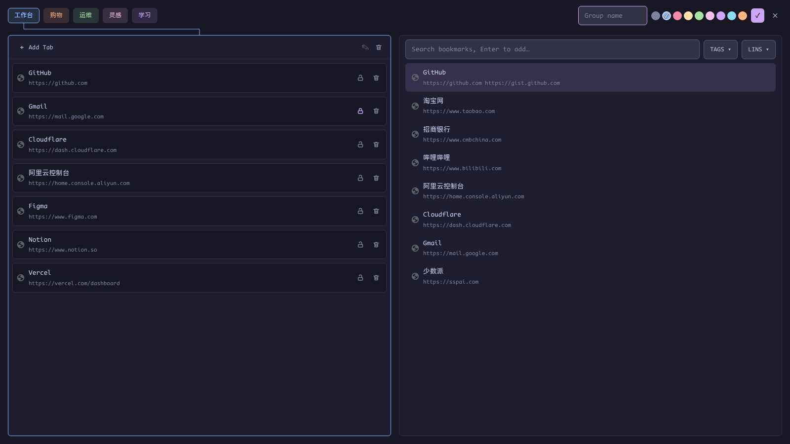
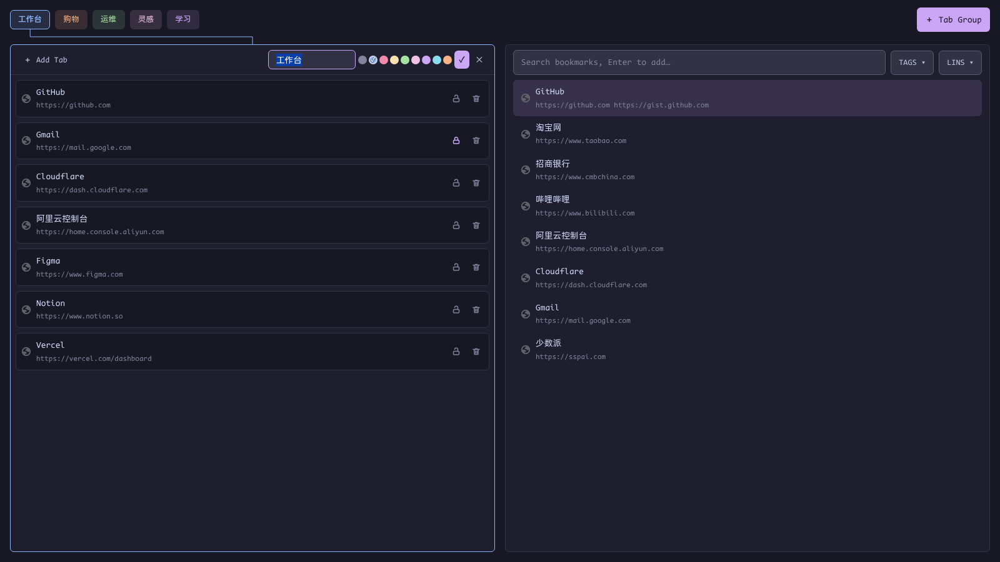
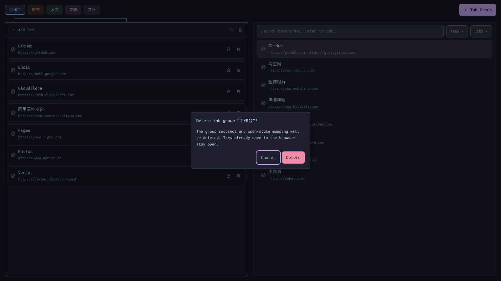
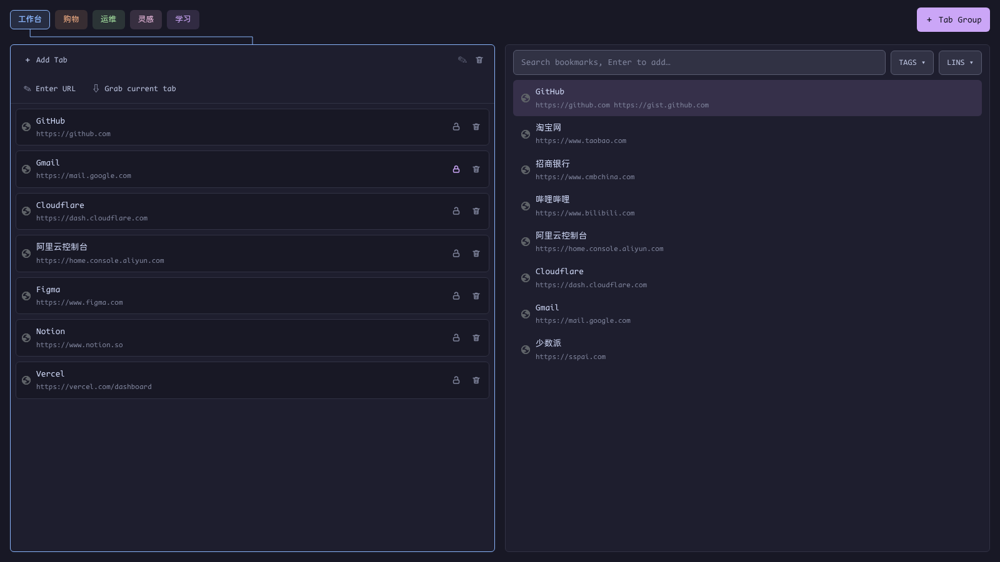

# Tab Group Manager

[简体中文](zh-CN/groups.md) | [← Back to README](../../README.md)

---

Press `Alt+,` to toggle the groups view (press it again to close). It solves one concrete annoyance: after the browser is gone, reopening a set of tabs means "new tab → show bookmarks bar → find the saved group". vipper keeps the whole snapshot at hand and rebuilds it with `Enter`.

## A snapshot library, not Chrome's saved groups

Chrome exposes no extension API to enumerate tab groups saved in the bookmarks bar (`chrome.tabGroups.query` only returns currently open groups). vipper therefore keeps its own snapshot library:

- A group = **name + one of Chrome's 9 group colors + ordered pages**
- A page = URL + title + a `locked` flag
- Stored in `storage.local`; no secrets, no encryption
- Separate from Chrome's saved tab groups — vipper neither reads nor overwrites them, and the native features keep working as usual

## The view

### Top: group chips

- Every group in order, tinted with its own color
- `＋ Tab Group` at the end of the row creates a group
- When the chips overflow, the row scrolls horizontally with fading edges
- **Click = select** (the left panel shows its pages); **long-press 400 ms and drag = reorder**
- The initial selection is the group you last opened with `Enter`; with no history it falls back to the first group
- A connector line in the selected group's color links the selected chip to the management panel; it hides when the chip scrolls out of view

### Left: pages in the selected group

- Header: `＋ Add Tab`, `✎` edit, delete
- Each row: favicon, title, URL, lock / delete buttons
- Long-press 400 ms to drag pages into order; deleting a page closes its browser tab when the group is open

### Right: bookmark search

- Reuses the bookmark vault directly: search (including pinyin) plus TAGS/LINS filters
- Only lists **active bookmarks that have at least one URL** (a note-only record has no page to add)
- `↑/↓` picks a result, `Enter` appends it to the end of the selected group; multi-URL bookmarks open the usual submenu

## Keyboard

| Key | Action |
|---|---|
| `Alt+,` | Open / close the groups view |
| `←` / `→` | Move the selection across chips |
| `Enter` | Open the selected group in the browser |
| `/` | Jump to the search box on the right |
| `Ctrl+/` | Return from the search box to the chips |
| `↑` / `↓` | Move the search-result selection |
| `Enter` | Append the selected bookmark to the current group |
| `Esc` | Close a form / menu; from search, back to chips; on chips, close the window |

> While the search box has focus, `/` is always a literal character — no accidental focus jumps.

## Creating, editing, deleting

### Create

Click `＋ Tab Group`: an inline form opens in the chips row with a name field, the 9 Chrome colors, and ✓/✕. `Enter` saves, `Esc` cancels.

### Edit

Click `✎` in the left panel header to open the same form in place. Saving updates the snapshot and the chip; if the group is already open in the browser, its Chrome group title and color are updated too.

### Delete

Click the delete icon in the left panel header. A page-level confirmation names the group:

- Focus starts on **Cancel**; `Esc` or clicking the backdrop also cancels
- Confirming deletes the **entry snapshot and the open-state mapping** — tabs already open in the browser are not closed

## Pages inside a group

### Add a page

`＋ Add Tab` offers two entry points:

- **Enter URL**: an inline URL + title form
- **Grab current tab**: takes the active tab from the source window

When the group is already open in the browser, a new entry immediately creates a real tab and joins it to the Chrome group.

### Lock a page

The lock icon on each row freezes the entry:

- While locked, closing or navigating that tab in the browser never rewrites the snapshot
- The next time the group opens, the page is rebuilt from the snapshot
- Click again to unlock and resume live sync

### Reorder and remove

- Long-press 400 ms and drag a page, then drop it into place; when the group is open, the browser tabs move with it
- Click the delete button to remove a page; when the group is open, the matching tab closes too

## Opening and live sync

### Open with Enter

1. Create tabs in the **source window**, in snapshot order
2. Group them into a real Chrome tab group and write the group name and color
3. Activate the first entry and collapse the window's other groups — the new group is the only one expanded
4. Reorder the already-open vipper groups in that window to match the chip order

If the group is already open, `Enter` just activates its first tab instead of creating a duplicate.

### While open: two-way sync

- **Browser → manager**: a tab that enters the group becomes an entry; leaving the group or closing a single tab removes its entry; navigation updates URL and title
- **Manager → browser**: deleting an entry closes a tab, dragging reorders tabs, adding an entry creates a tab and joins the group
- Locked entries are exempt in both directions

### Closing semantics

- **Closing a single tab** = delete that page
- **Closing the whole window / the whole Chrome group** = only the live mapping is invalidated; **the snapshot is kept intact**
- The snapshot survives a browser restart: press `Alt+,` again and hit `Enter` to rebuild

### Extension reloads

The mapping lives in `chrome.storage.session`, which Chrome clears when the extension is reloaded or updated. If the Chrome group is still in the window, vipper recognizes it by **group title + color**, so `Enter` activates it instead of creating a duplicate. It deliberately does not rebuild the per-tab mapping — matching tabs by position could scramble entries.

## Boundaries

- Chrome's saved tab groups cannot be imported; vipper does not modify them
- Snapshots are not encrypted (URLs and titles are not credentials)
- A group opens in the source window; if that window is gone, vipper falls back to the most recent normal window
