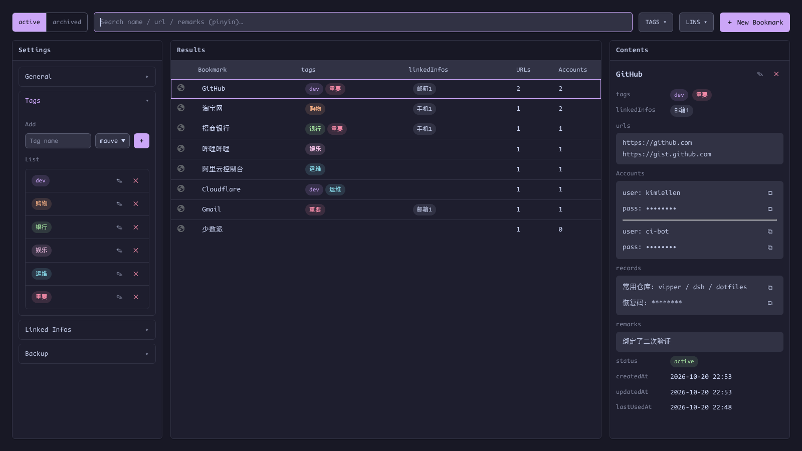

# Tags, Linked Infos & Archive

[English](organization.md) | [简体中文](zh-CN/organization.md) · [← Back to README](../../README.md)

---

## Tags

Settings → **Tags** manages the global tag table: name + one of 14 Catppuccin colors, inline editing, and an add row with a color swatch picker:

- **Create-first, select-later**: tags can only be attached to a bookmark after they exist here — no on-the-fly creation, so near-variants like `dev` / `Dev` / `开发` never multiply
- **Reference-safe delete**: a tag used by any bookmark refuses to be deleted and tells you how many entries reference it

## Linked infos

Settings → **Linked Infos** is the same pattern with free-named `{ name, value }` pairs — 手机1, 邮箱1, 微信… Attach them to bookmarks to keep "which phone/email did I register with" one click away. Duplicate names/values are rejected; referenced entries can't be deleted.

Both tables feed the toolbar's [TAGS/LINS filters](bookmarks.md#tags--lins-filters).

## Archive

The toolbar's **active / archived** switch decides which set you're searching and viewing — archived entries never pollute the active list (and never match Alt+P or save-on-login).

Two ways to archive (and restore, symmetrically):

1. **Manually** — set `status` to archived in the bookmark's [edit mode](bookmarks.md#editing-in-place)
2. **Automatically** — Settings → General → *Auto-archive*: entries unused for more than N days are archived at browser start and then daily. `0` (the default) disables it entirely

Archiving moves data between storage keys and flips the index status — there are no real files involved.
