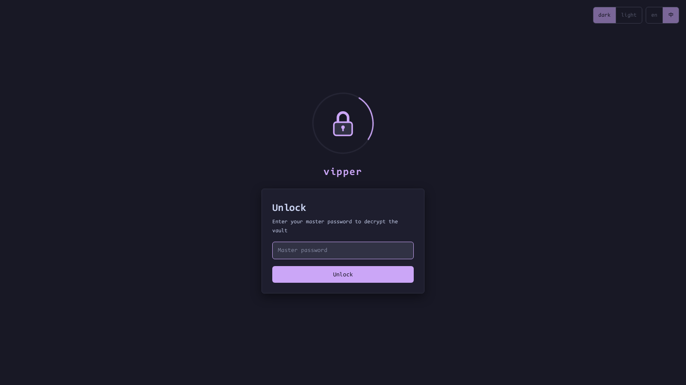

# Security Model

[English](security.md) | [简体中文](zh-CN/security.md) · [← Back to README](../../README.md)

---

vipper is a local-first vault. There are no servers, no sync, no telemetry — data is readable only through the extension itself.

## Encryption

- **Master password → key**: PBKDF2-SHA256, 600,000 iterations
- **Encryption**: AES-GCM via the browser's native **WebCrypto** — zero third-party crypto dependencies
- Ciphertext is self-describing — `{"$enc":"v1","iv":…,"data":…}` — so algorithms and keys can migrate in the future

## What is encrypted

| Field | State |
|---|---|
| `accounts[].password` | encrypted |
| `records[].content` (secret template) | encrypted, displayed masked as `*` |
| everything else (titles, URLs, remarks, notes, tags…) | plaintext — deliberately, to stay searchable |

## The key never persists

- The derived key lives in **`chrome.storage.session` only** — restarting the browser always locks the vault
- Optional idle-timeout locking is off by default (`0` minutes), configurable in [Settings](settings.md)
- The unlock screen routes itself: first run → create password; locked → unlock; unlocked → straight to the manager
- While locked, [save-on-login](auto-save.md) captures are **discarded silently** — plaintext is never staged waiting for an unlock

## No backdoor, by design

There is intentionally **no "forgot password" flow** — such a flow would be a data-wipe button for anyone with access to your unlocked desktop.

To reset (this **permanently deletes all bookmarks, accounts and records** — without the master password the ciphertext is unrecoverable):

1. `chrome://extensions` → vipper card → **Details**
2. Under "Inspect views", click **service worker** — DevTools opens
3. DevTools → **Application** → **Storage** → **Extension storage** → right-click **Local** → **Clear**
4. Reopen vipper (`Alt+.`) → the create-password flow returns

With an [exported JSON backup](backup.md), you can re-import after the reset.

> By the same token, this is the **only way to change your master password**: clear the local data → create a new master password → import your previous backup (the ciphertext in the backup is re-encrypted with the new key on import).

## Import/export guards

Both [export and import](backup.md) ask for the master password on the spot. Exports are fully plaintext so that your data is never locked to this extension — store the exported JSON file somewhere safe yourself.
