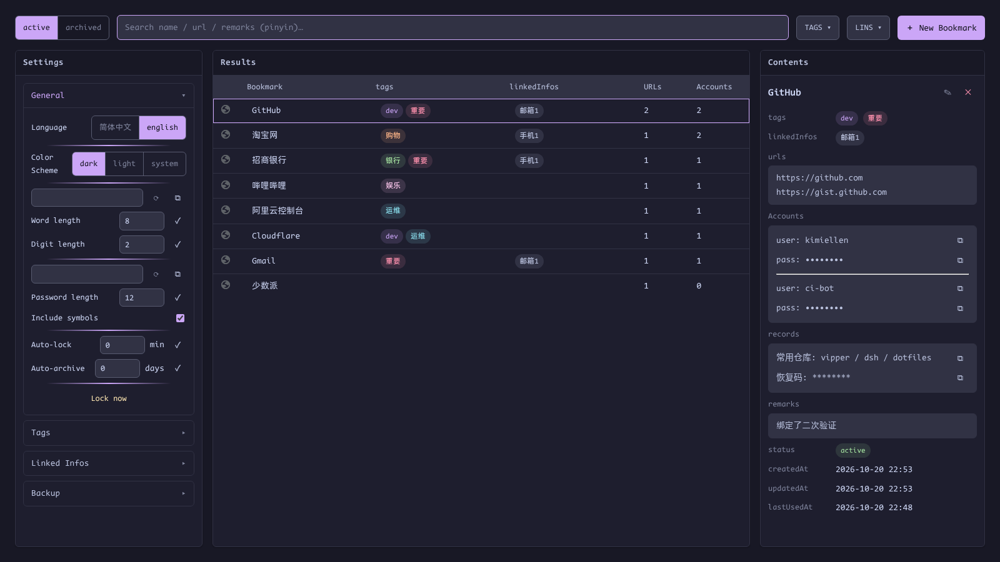
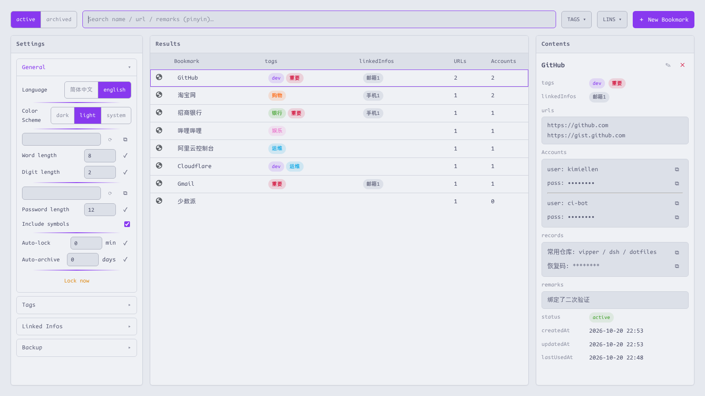

# Settings

[English](settings.md) | [简体中文](zh-CN/settings.md) · [← Back to README](../../README.md)

---

Settings → **General** holds the page-level preferences; all of them persist and also apply to the locked screen (whose corner toggles theme and language before you unlock):

| Setting | Values | Notes |
|---|---|---|
| Language | 简体中文 / English | Whole UI, including the save-on-login card |
| Color scheme | dark / light / system | Catppuccin Mocha (dark) / Latte (light); `system` follows the OS |
| Username generator | word length, digit length | Word-combination usernames |
| Password generator | length, symbols | Used by the ✓/⟳ controls in the account editor |
| Auto-lock | minutes, `0` = off (default) | Sliding idle timeout; the browser restart always locks regardless |
| Auto-archive | days, `0` = off (default) | See [Archive](organization.md#archive) |
| Lock now | button | Clears the session key and returns to the unlock screen immediately |

## Themes

Dark (Catppuccin Mocha) is the default; light is Catppuccin Latte:

The save-on-login card and Alt+P menus follow the same setting — `system` is resolved via `prefers-color-scheme` inside each page.
