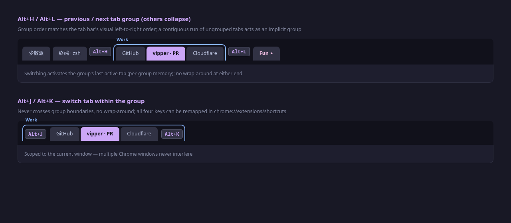

# Tab Navigation

[English](tab-navigation.md) | [简体中文](zh-CN/tab-navigation.md) · [← Back to README](../../README.md)

---

vipper makes Chrome tab navigation fully keyboard-driven: `Alt+H/L` moves between tab groups, `Alt+J/K` moves within a group — no mouse, no matter how many tabs you have.

## Keys

| Key | Action |
|---|---|
| `Alt+H` / `Alt+L` | Previous / next **tab group** |
| `Alt+J` / `Alt+K` | Previous / next tab **within the group** |

> The defaults are vim-style letter keys. All four can be remapped in `chrome://extensions/shortcuts`.

## Exact semantics

- **Groups are Chrome's native Tab Groups**, ordered by their visual left-to-right position in the tab bar.
- **Implicit groups**: a contiguous run of ungrouped tabs counts as one group. Two runs separated by a real group are two different implicit groups — navigation always matches what you see.
- **Per-group memory**: switching to a group activates the tab you last used in that group.
- **Fold as you go**: the target group expands, all other groups collapse.
- **No wrap-around**: pressing past either end does nothing.
- **Window-scoped**: only the current Chrome window is considered; other windows are untouched.

## Notes

- The four keys are preset via `chrome.commands` and work globally in the browser — no page focus required.
- Group switching works on any tab, grouped or not; the current group is derived from the active tab's position.
