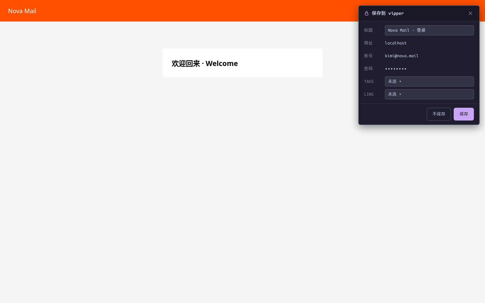
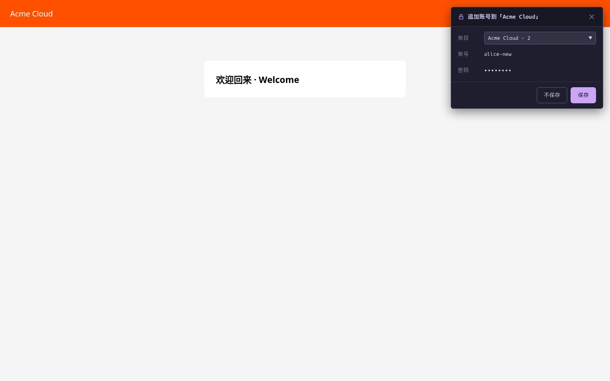

# 登录自动保存

[English](../auto-save.md) | 简体中文 · [← 返回 README](../../../README.zh-CN.md)

---

照常登录一个网站。如果 vipper 还没有对应凭据，页面落定后**右上角**会滑入一张非阻断的浮卡——不弹模态、不抢焦点。

## 新建条目

没有任何书签匹配该站点 → 浮卡提供新建：标题可编辑，网址 / 账号只读，密码遮蔽，可先选 TAG/LINS：

「保存」即加密落盘（URL 匹配规则默认 `host`）；「不保存」、`Esc` 或 `✕` 丢弃。

## 追加账号

有书签匹配、但不含这个 username → 浮卡提供**追加**到已有条目（下拉默认最近使用的匹配条目；只有一条匹配也显示下拉，便于确认目标）：

任一匹配条目已含该 username 时保持静默——不做密码更新提示；改密码请去[编辑态](bookmarks.md#原地编辑)手动修改。

## 什么时候不弹

- 凭据库**锁定**——捕获直接静默丢弃，不会暂存明文等解锁
- 注册 / 改密表单（可见密码框 ≥2）直接忽略
- 提交的值与本 frame 最近一次 Alt+P 自动填充完全相同（未修改）时忽略
- 归档条目不参与匹配——已归档站点按新建处理

## 捕获的隐私处理

捕获的凭据只存在于 service worker 的**内存**——不写任何 storage、不进日志。保存即加密落盘并清除；丢弃即清除。service worker 被回收时宁可丢掉 pending，也不会写入错误数据。

## 已知边界

- 无法可靠判定登录是否成功——失败的登录也可能弹窗；文案保持中性、可取消
- 无可见账号框的多步登录（仅密码步）不捕获；弹窗登录 / 新标签方式登录可能错过
