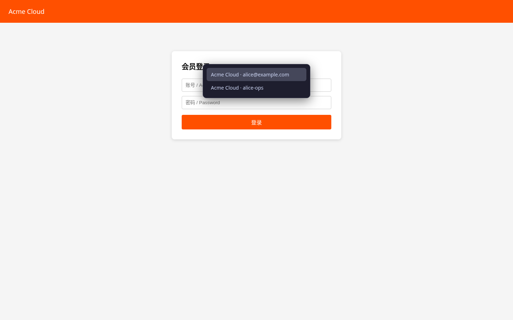

# 主动填充（Alt+P）

[English](../autofill.md) | 简体中文 · [← 返回 README](../../../README.zh-CN.md)

---

在任意登录页按 `Alt+P`，vipper 按书签的 URL 匹配规则找到对应条目并填入账号密码——Bitwarden 式的体验，带一点仪式感：账号**逐字符键入**、弹跳，然后密码重复同样的节奏。

## 匹配规则

每条书签 URL 带一条规则（在[编辑态](bookmarks.md#原地编辑)中选择）：

| 规则 | 匹配条件 |
|---|---|
| `host`（默认） | hostname 相同（端口/路径/协议不参与） |
| `exact` | origin + pathname 相同（忽略 query/hash） |
| `prefix` | 页面 URL 以书签 URL 开头 |

归档条目不参与匹配；无匹配时按了也没反应。

## 多账号

书签含多组账号时，页面内弹出方向键二级菜单（`↑/↓` 选择 + 回车确认）；菜单自动接管键盘焦点（即使登录表单在跨域 iframe 里），关闭后还给原元素：

## 填充反馈

- 逐字符键入（每字约 20ms，单字段按约 1s 预算自动压缩），完成后字段 200ms 弹跳——先账号、后密码
- 系统开启「减少动效」（`prefers-reduced-motion`）时两者都跳过：值一次写入，仍派发最终的 `input`/`change` 事件（React/Vue 受控组件兼容）
- 浏览器对不可见跨域 iframe 会把 `setTimeout` 钳到约 1 秒；vipper 实测到节流后，本字段剩余部分与后续字段直接整段写入，不会退化成 1 秒/字

## 健壮性细节

- **跨域 iframe**：163 邮箱、阿里云、Apple ID 这类登录表单在 iframe 内的站点，由 service worker 探测实际承载表单的 frame 后定向填充；菜单与错误提示只在顶层页面展示
- **诱饵字段**：只认**可见**输入框——0 尺寸的诱饵密码框不写
- **账号框锚定**：存在密码框时，账号框取同一 form 内、DOM 上紧邻密码框之前的可见文本框——页头搜索框不会被误填；显式 `autocomplete="username/email"` 仍然最高优先
- **旧标签页**：扩展重载前打开的页面没有 content script，vipper 按需自动补注入——无需刷新页面
- **锁定状态**：按 `Alt+P` 改为打开 / 聚焦解锁页；解锁后回到登录页再按一次即可

## 设计上不覆盖

content script 无法注入 `chrome://` 页面、新标签页与 Web Store。
