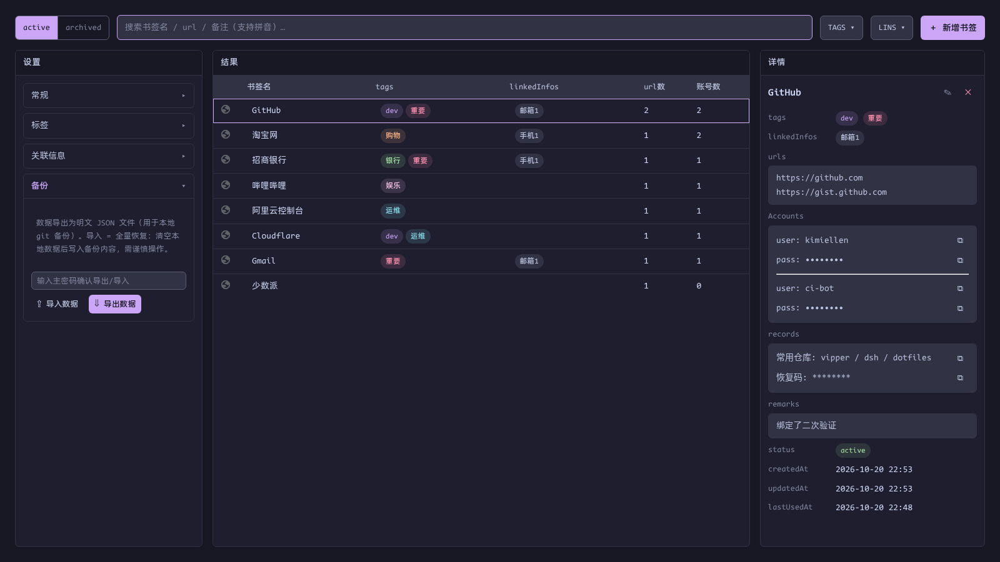

# 备份：导入与导出

[English](../backup.md) | 简体中文 · [← 返回 README](../../../README.zh-CN.md)

---

设置 → **备份**：

## 导出

一键导出**全量明文 JSON**——书签（active + archived）、tag 表、关联信息表与设置。导出当场要求输入主密码确认。

明文导出是有意设计：导出文件的正统去向是提交进**本地 git 仓库**，形成备份轨迹。请把它当作密码库文件对待——因为它就是。

## 导入

导入是**数据恢复，不是合并**：校验文件结构后**清空**现有书签与管理表再写入。同样需要当场输入主密码——没有人能往你解锁着的窗口丢一个文件就覆盖掉整个仓库。

- 文件中的敏感字段写入时会用*你的*密钥重新加密

## 推荐节奏

1. 有较大改动后导出一次
2. 把 JSON 提交进本地（私有）git 仓库
3. 需要恢复时导入最近一次导出

软链扩展的 LevelDB 目录理论上可行，但不推荐——二进制噪音大、恢复脆弱。
