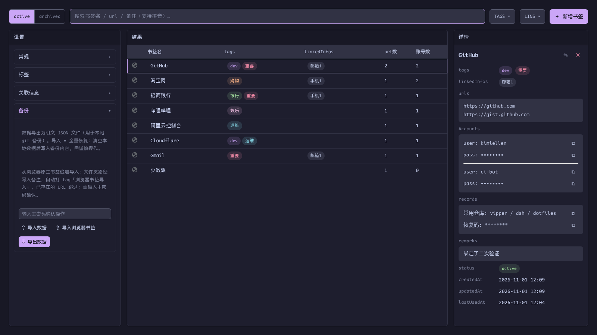

# 备份：导入与导出

[English](../backup.md) | 简体中文 · [← 返回 README](../../../README.zh-CN.md)

---

设置 → **备份**：

## 导出

一键导出**全量明文 JSON**——书签（active + archived）、tag 表、关联信息表与设置。导出当场要求输入主密码确认。

明文导出是有意设计：导出文件的正统去向是提交进**本地 git 仓库**，形成备份轨迹。请把它当作密码库文件对待——因为它就是。

## 导入

导入是**数据恢复，不是合并**：校验文件结构后**清空**现有书签与管理表再写入。同样需要当场输入主密码——没有人能往你解锁着的窗口丢一个文件就覆盖掉整个仓库。

- 文件中的敏感字段写入时会用*你的*密钥重新加密

## 导入浏览器书签

Chrome 原生书签可以直接拉进仓库——不用先导出 HTML，也不用选文件。vipper 读取实时书签树、展平成条目，逐条追加进仓库。

### 会导入什么

- 所有**带 URL 的书签**，来自书签栏、“其他书签”以及任意层级文件夹（文件夹本身不算条目）
- 原始标题；标题为空时回落为 URL
- 文件夹路径写入**备注**——例如 `书签栏 / 开发 / Vue`，备注仍参与搜索
- 每条导入条目自动关联 tag **浏览器书签导入**（首次导入时以 `sapphire` 色创建，之后复用）
- 条目状态为 **active**；`createdAt` 保留 Chrome 的 `dateAdded`，`lastUsedAt` 取导入时间，因此会排在列表顶部

### 处理逻辑（只追加，不破坏）

- **追加而非恢复**：已有书签与 tag / 关联信息表原样保留——与上面的 JSON 导入不同，不清空任何数据
- **重复跳过**：URL 经规范化（`URL.href`，末尾斜杠与主机大小写不影响比较）后精确比较；仓库里已存在的 URL（active 或 archived）计入“跳过”，不会产生重复条目
- **同一道主密码闸门**：导出、JSON 导入、浏览器书签导入共用一个主密码输入框；密码错误时一个字节都不会写入
- **批量落盘**：整批条目一次写入、索引只更新一次，导入上百条书签也不会变慢
- vipper 只**读取** Chrome 书签，不会新增、移动或删除它们

### 操作步骤

1. 按 `Alt+.` 打开管理页，展开 **设置 → 备份**
2. 在输入框里输入主密码
3. 点击 **⇪ 导入浏览器书签**
4. 查看结果提示，例如 `导入完成：新增 12 条，跳过 3 条重复`
5. 新条目已在列表中——如果你正在搜索或过滤，清空搜索或切回 `active` 即可看到

> 扩展需要 `bookmarks` 权限。更新后首次加载时 Chrome 可能提示“读取和更改您的书签”，未接受前导入按钮会报缺少权限。

### 说明与边界

- 不会重建 Chrome 的**文件夹**结构；路径保留在备注里。需要更丰富的组织方式时，可再补 tag / 关联信息
- 只带走标题、URL、文件夹路径与创建时间——图标与访问记录不会导入
- 重复导入是安全的：已存在的 URL 全部跳过

## 推荐节奏

1. 有较大改动后导出一次
2. 把 JSON 提交进本地（私有）git 仓库
3. 需要恢复时导入最近一次导出

软链扩展的 LevelDB 目录理论上可行，但不推荐——二进制噪音大、恢复脆弱。
