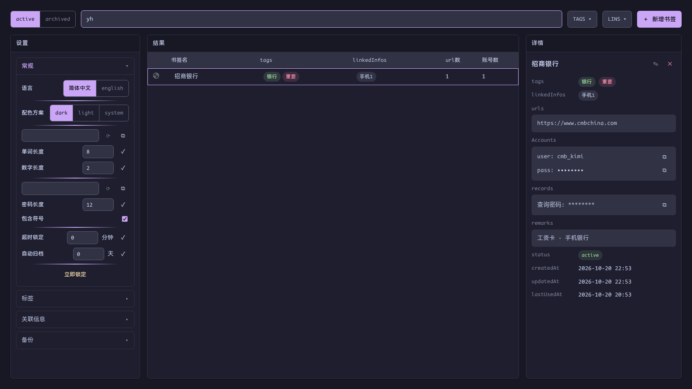
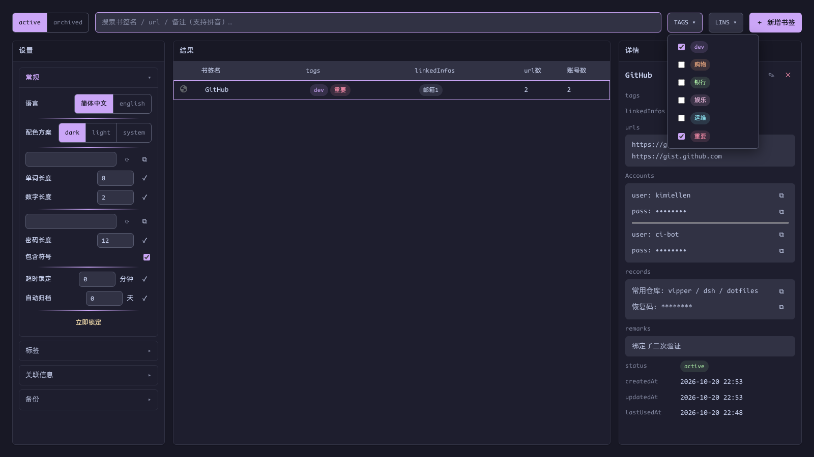
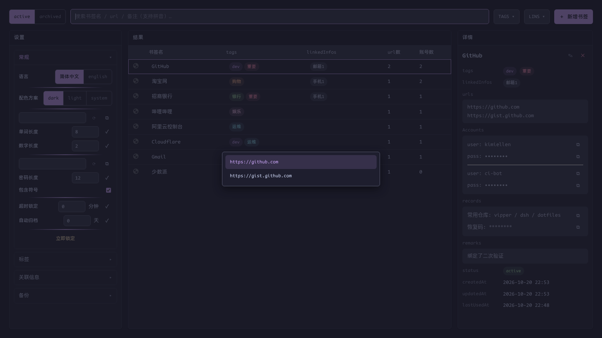
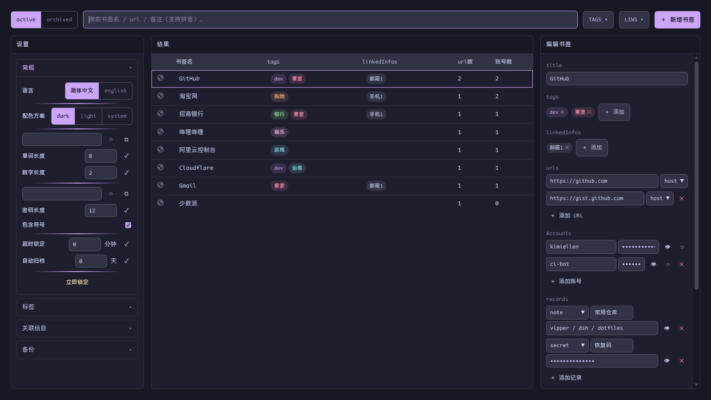

# 书签管理

[English](../bookmarks.md) | 简体中文 · [← 返回 README](../../../README.zh-CN.md)

---

按 `Alt+.` 呼出 / 关闭管理页。它是一个整页不滚动的固定高度页面，四个区域：

- **顶行工具栏**——active/archived 切换、搜索、TAGS/LINS 多选过滤、新增书签
- **设置**——手风琴（常规 / 标签 / 关联信息 / 备份）
- **结果**——书签表格，按最近使用降序，首列 favicon
- **详情**——选中条目的内容；原地切换为编辑态

## 搜索——支持中文拼音

搜索匹配书**签名、url、备注**。中文书签名与备注额外支持**拼音首拼与全拼**：

`yh` / `yinhang` 命中招商银行，`tb` / `taobao` 命中淘宝网。多音字按词级处理（重庆 → `cq`，长沙 → `cs`）。url 不做拼音转换，按原文匹配。

## TAGS / LINS 过滤

顶行两个下拉可多选 tag 与关联信息，多个选项之间是 **AND** 语义：

过滤选择会**按浏览器会话记忆**：`Alt+.` 关窗再开，上次的过滤视图自动恢复；浏览器重启后复位；已删除的 tag 在恢复时自动剔除。搜索词与 active/archived 切换不恢复。

## 打开书签

选中条目按 `Enter`，书签会在**你来源标签所在的标签组**里打开——新标签加入当前上下文，而不是掉到标签栏末尾。多 URL 书签会弹出方向键二级菜单：

`Esc` 先关菜单，再按关窗。

## 原地编辑

点详情区右上角 `✎`（或「＋ 新增书签」）——详情区原地切换为编辑态，不跳转页面：

- 字段顺序与展示态一致：title → tags → linkedInfos → urls → accounts → records → remarks → status，三个只读时间置于最底部
- **urls**：每条 URL 带匹配规则——`host`（默认，仅比较 hostname）、`exact`（origin + pathname）、`prefix`——供 Alt+P 与登录自动保存判定"当前页面是否适用此 URL"
- **accounts**：任意多组账号密码，带显隐切换与密码生成器
- **records**：可重复添加的 `note`（明文）与 `secret`（加密落盘、遮蔽显示）——恢复码、API Key、密保答案……
- tag 与关联信息**先建后选**：必须先在设置里建好才能挂载，防止相近语义重复添加

`Esc` 取消编辑；删除书签有确认提示。
