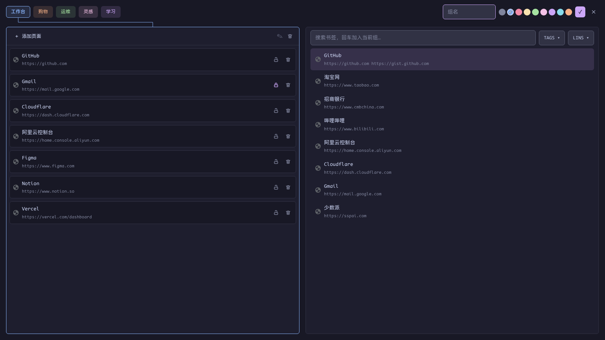
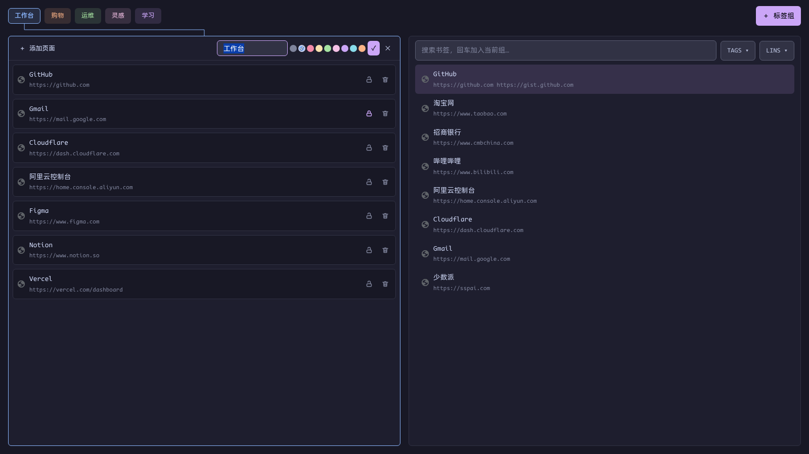
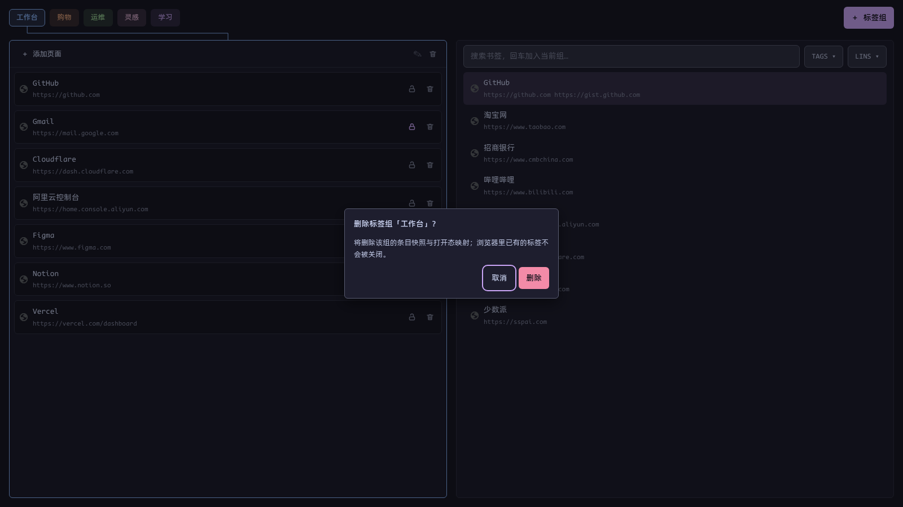
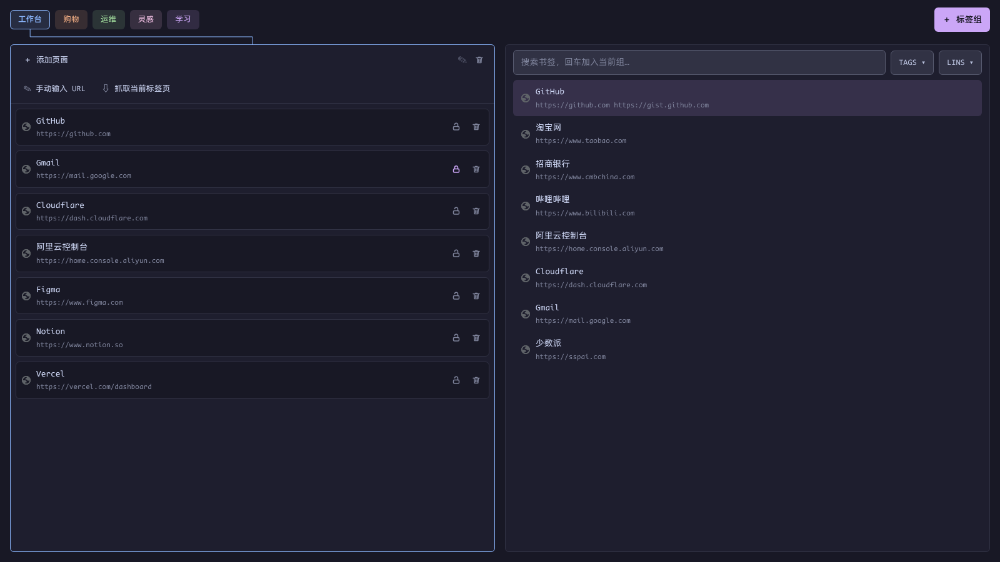

# 标签组管理

[English](../groups.md) | 简体中文 · [← 返回 README](../../../README.zh-CN.md)

---

按 `Alt+,` 呼出 groups 视图（再按一次关闭）。它解决一个具体麻烦：浏览器关掉后，要重开一组标签，原生路径是「新标签页 → 显示书签栏 → 找到保存的组」；vipper 把整组快照放在手边，回车就重建。

## 快照，而不是 Chrome 的保存组

Chrome 没有提供枚举「书签栏里保存的标签组」的扩展 API（`chrome.tabGroups.query` 只返回当前打开的组）。所以 vipper 维护自己的快照库：

- 一个组 = **名称 + Chrome 9 色之一 + 有序页面**
- 每个页面 = URL + 标题 + `locked` 标记
- 存在 `storage.local`，无敏感信息，不加密
- 与 Chrome 的 saved tab groups 是两套数据：vipper 不读取、也不覆盖它们；Chrome 原生功能照常可用

## 界面

### 顶部：组 chips

- 所有组按顺序横排，chip 用组色着色
- 行末 `＋ 标签组` 新建
- chips 超出宽度时横向滚动，左右边缘渐隐
- **单击 = 选中**（左栏显示它的页面）；**长按 400ms 拖动 = 排序**
- 初始选中 = 最后一次回车打开过的组；没有记录时回退到第一个
- 选中 chip 与管理栏之间有一条同色连接折线；chip 滚出视口时折线隐藏

### 左栏：当前组的页面

- 头部：`＋ 添加页面`、`✎` 编辑、删除
- 每行：favicon、标题、URL、锁定 / 删除按钮
- 长按 400ms 拖动排序；删除页面在组已打开时会同步关掉浏览器标签

### 右栏：书签搜索

- 直接复用书签库：搜索（含拼音）+ TAGS/LINS 过滤
- 只列出 **active 且至少有一个 URL** 的书签（纯记录没有页面可加）
- `↑/↓` 选择结果，`Enter` 追加到当前组末尾；多 URL 书签会弹二级菜单选具体 URL

## 键盘流

| 按键 | 作用 |
|---|---|
| `Alt+,` | 打开 / 关闭 groups 视图 |
| `←` / `→` | 在 chips 间移动选中 |
| `Enter` | 在浏览器中打开选中的组 |
| `/` | 光标跳到右栏搜索框 |
| `Ctrl+/` | 从搜索框回到 chips |
| `↑` / `↓` | 移动搜索结果选中 |
| `Enter` | 把搜索结果追加到当前组 |
| `Esc` | 关表单 / 菜单；搜索框里退回 chips；在 chips 上关闭窗口 |

> 光标在搜索框时 `/` 永远是普通字符，不会误触切换。

## 新建、编辑、删除

### 新建

点 `＋ 标签组`，chips 行内展开表单：组名 + 9 个 Chrome 色点 + ✓/✕。`Enter` 保存，`Esc` 取消。

### 编辑

点左栏头部的 `✎`，同一位置展开同构表单。保存后更新快照与 chip；组已在浏览器中打开时，Chrome 组的标题和颜色一起更新。

### 删除

点左栏头部的删除图标，弹出带组名的页面内确认：

- 默认焦点在「取消」，`Esc` 或点遮罩取消
- 确认后删除的是**条目快照与打开态映射**；浏览器里已经存在的标签不会被关闭

## 管理组里的页面

### 添加页面

`＋ 添加页面` 提供两个入口：

- **手动输入 URL**：内联输入 URL 与标题
- **抓取当前标签页**：取来源窗口的活动标签

组已经在浏览器中打开时，新增条目会立即创建真实标签并加入 Chrome 组。

### 锁定页面

每行右侧的锁图标把条目冻结：

- 锁定后，浏览器里关闭或跳转这个标签，都不会改写快照
- 下次打开组时，该页面仍按快照重建
- 再点一次解锁，恢复实时同步

### 排序与移除

- 长按 400ms 拖动页面，松手落位；组已打开时同步移动浏览器标签
- 点删除按钮移除页面；组已打开时同步关闭对应标签

## 打开与实时同步

### 回车打开

1. 在**来源窗口**按快照顺序批量创建标签
2. 把它们合成一个 Chrome 标签组，写入组名与颜色
3. 激活第一条，并把同窗口的其他组折叠——新组独占展开态
4. 按 chips 顺序整理窗口内已打开的 vipper 组

如果这个组已经打开，回车只激活它的第一个标签，不会重复建组。

### 打开期间：双向同步

- **浏览器 → 管理页**：进组的新标签成为条目，出组 / 单个关闭的标签移除条目，跳转更新 URL 与标题
- **管理页 → 浏览器**：删条目关标签、拖动排序移动标签、添加条目创建标签并加入组
- 锁定条目对两个方向都豁免

### 关闭语义

- **关闭单个标签** = 删除该页面
- **关闭整个窗口 / 整个 Chrome 组** = 只让实时映射失效，**快照完整保留**
- 浏览器重启后快照仍在：重新 `Alt+,`，回车即可重建

### 扩展重载

映射存在 `chrome.storage.session`，扩展重载 / 更新会清空它（Chrome 行为）。窗口里的 Chrome 组还在时，vipper 用「组标题 + 颜色」认回同一个组，回车只激活、不重复建；但不会重建逐标签映射，避免按位置把条目串错。

## 边界

- Chrome saved tab groups 无法导入；vipper 也不修改它们
- 快照没有加密（URL 与标题不是凭据）
- 组只在来源窗口打开；来源窗口不存在时回退到最近的普通窗口
