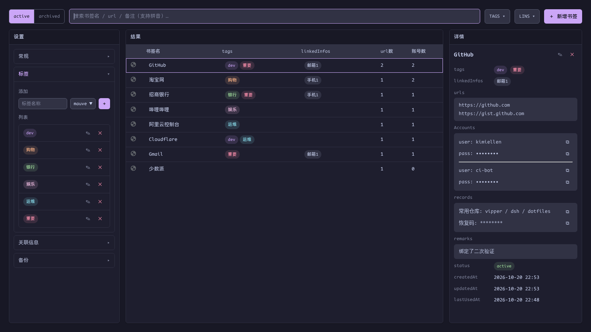

# 标签、关联信息与归档

[English](../organization.md) | 简体中文 · [← 返回 README](../../../README.zh-CN.md)

---

## 标签（tags）

设置 → **标签**管理全局 tag 表：名称 + 14 种 Catppuccin 配色之一，支持行内编辑，添加行带色块选择器：

- **先建后选**：tag 只能在这里建好后才能挂到书签上——不支持即输即建，`dev` / `Dev` / `开发` 这类相近语义的重复不会滋生
- **引用保护**：被任何书签引用的 tag 拒绝删除，并提示引用数量与条目标题

## 关联信息（linkedInfos）

设置 → **关联信息**是同样的模式，自由命名的 `{ name, value }` 对——手机1、邮箱1、微信……挂到书签上，"这个网站当初用哪个手机号/邮箱注册的"一键可查。重名 / 重值会被拒绝；被引用的条目不可删除。

两张管理表同时是顶行 [TAGS/LINS 过滤器](bookmarks.md#tags--lins-过滤)的选项来源。

## 归档

顶行的 **active / archived** 切换决定当前搜索与展示哪一组——归档条目永远不会污染 active 列表（也不参与 Alt+P 与登录自动保存的匹配）。

归档的两种方式（恢复对称同理）：

1. **手动**——在书签[编辑态](bookmarks.md#原地编辑)把 status 改为 archived
2. **自动**——设置 → 常规 → *自动归档*：超过 N 天未使用的条目在浏览器启动时与每日定时扫描中归档。默认 `0` = 不开启

归档 = 数据在存储 key 之间搬移 + 索引状态翻转，不涉及真实文件。
