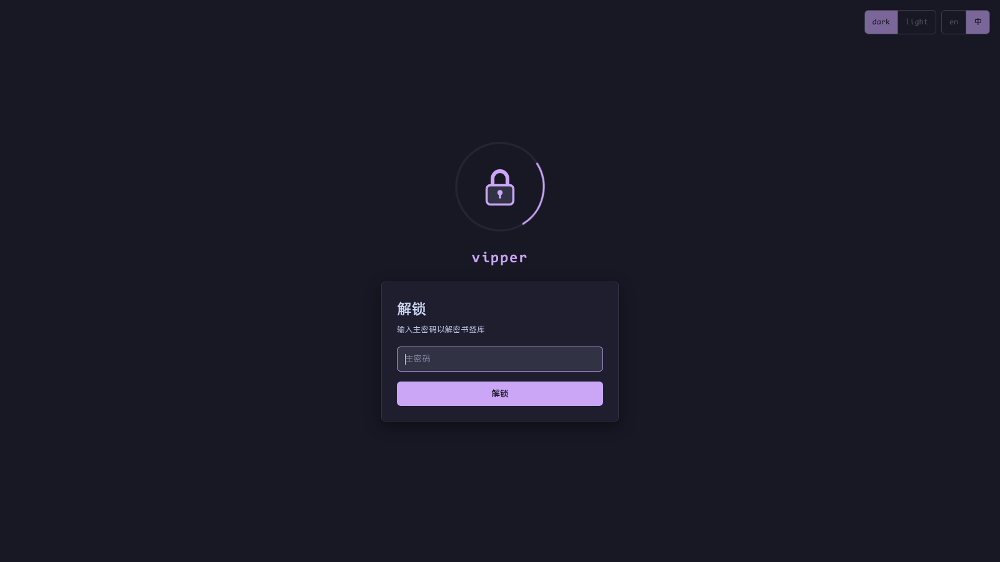

# 安全模型

[English](../security.md) | 简体中文 · [← 返回 README](../../../README.zh-CN.md)

---

vipper 是本地优先的凭据库：没有服务器、没有同步、没有遥测——数据只能通过扩展本身读取。

## 加密

- **主密码 → 密钥**：PBKDF2-SHA256，600,000 次迭代
- **加密算法**：AES-GCM，只用浏览器原生 **WebCrypto**——零第三方加密依赖
- 密文自描述——`{"$enc":"v1","iv":…,"data":…}`——便于将来算法 / 密钥迁移

## 加密的范围

| 字段 | 状态 |
|---|---|
| `accounts[].password` | 加密落盘 |
| `records[].content`（secret 模板） | 加密落盘，展示遮蔽为 `*` |
| 其余一切（书签名、URL、备注、note、tag……） | 明文——有意为之，以支持检索 |

## 密钥永不落盘

- 派生密钥只存 **`chrome.storage.session`**——浏览器每次重启即锁定
- 超时锁定默认关闭（`0` 分钟），可在[设置](settings.md)中配置
- 解锁页自动路由三态：首次 → 创建主密码；已锁定 → 解锁；已解锁 → 直接进主页面
- 锁定状态下，[登录自动保存](auto-save.md)的捕获**静默丢弃**——绝不暂存明文等待解锁

## 按设计不留后门

vipper **故意不提供"忘记密码"入口**——那种入口本质上是一个摆在解锁桌面上的数据清除按钮。

确认重置时（这会**永久删除全部书签 / 账号 / 记录**——没有主密码，密文无法解密）：

1. `chrome://extensions` → vipper 卡片 → **详细信息**
2. 在「检查视图 / Inspect views」处点击 **service worker**，打开 DevTools
3. DevTools → **应用 / Application** → 左侧 **存储 / Storage** → **Extension storage** → 右键 **Local** → **Clear**
4. 重新打开 vipper（`Alt+.`）→ 回到创建主密码流程

如果有[导出的 JSON 备份](backup.md)，重置后可导入恢复。

> 同理，这也是**修改主密码的唯一方法**：清除 local 数据 → 创建新主密码 → 导入之前的备份（备份里的密文导入时会用新密钥重新加密）。

## 导入导出的防护

[导出与导入](backup.md)都要求当场输入主密码。为了解除用户数据与本插件的绑定关系，导出的数据所有字段都是明文，请自行妥善保存导出的 json 文件。
