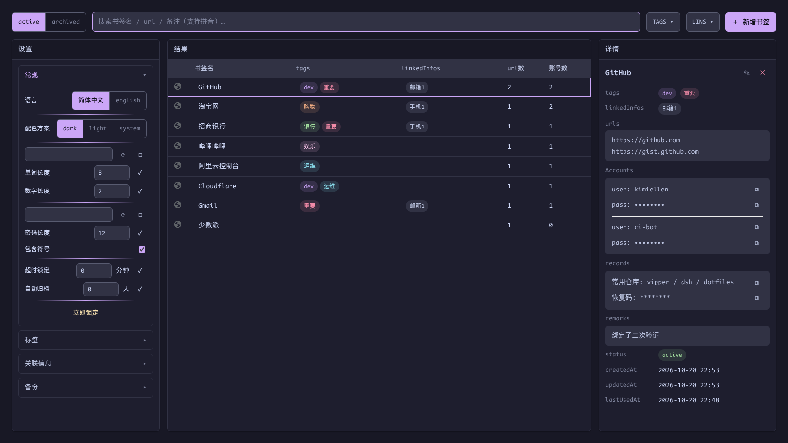
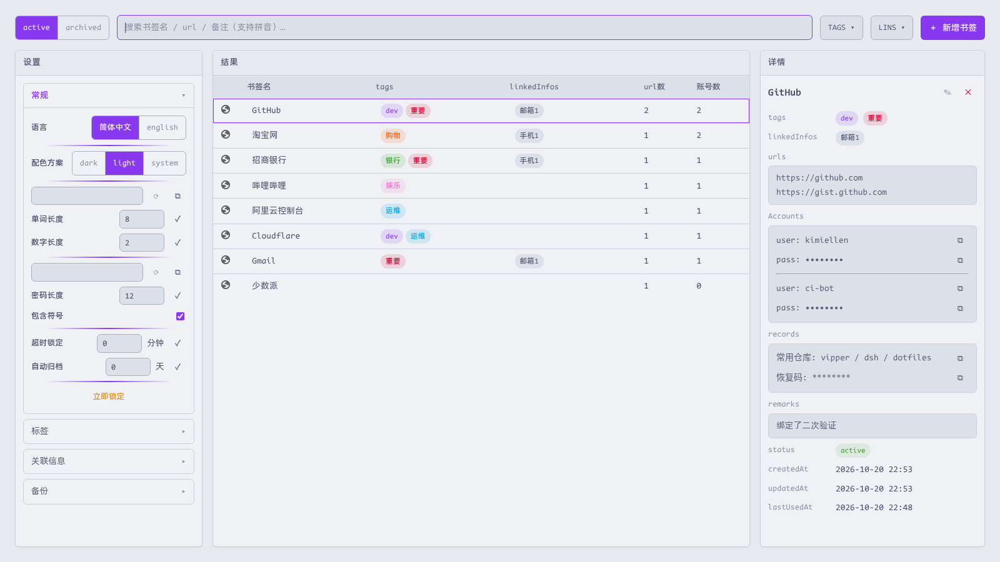

# 设置

[English](../settings.md) | 简体中文 · [← 返回 README](../../../README.zh-CN.md)

---

设置 → **常规**承载页面级偏好；全部持久化，并且对锁定页同样生效（锁定页角落可在解锁前切换主题与语言）：

| 设置 | 取值 | 说明 |
|---|---|---|
| 语言 | 简体中文 / English | 全界面生效，包括登录保存浮卡 |
| 配色方案 | dark / light / system | Catppuccin Mocha（dark）/ Latte（light）；`system` 跟随系统 |
| 用户名生成器 | 单词长度、数字长度 | 单词组合式用户名 |
| 密码生成器 | 长度、是否含符号 | 账号编辑处的 ✓/⟳ 控件使用 |
| 超时锁定 | 分钟，`0` = 关闭（默认） | 惰性滑动超时；无论此项如何，浏览器重启必锁 |
| 自动归档 | 天，`0` = 关闭（默认） | 见[归档](organization.md#归档) |
| 立即锁定 | 按钮 | 立刻清除会话密钥并回到解锁页 |

## 主题

默认深色（Catppuccin Mocha），浅色为 Catppuccin Latte：

登录保存浮卡与 Alt+P 菜单跟随同一设置——`system` 在各页面内通过 `prefers-color-scheme` 解析。
